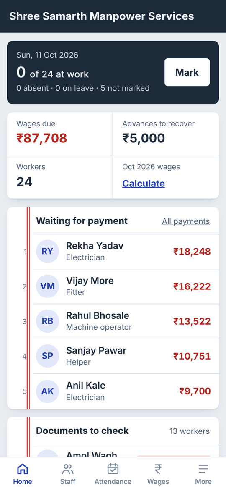
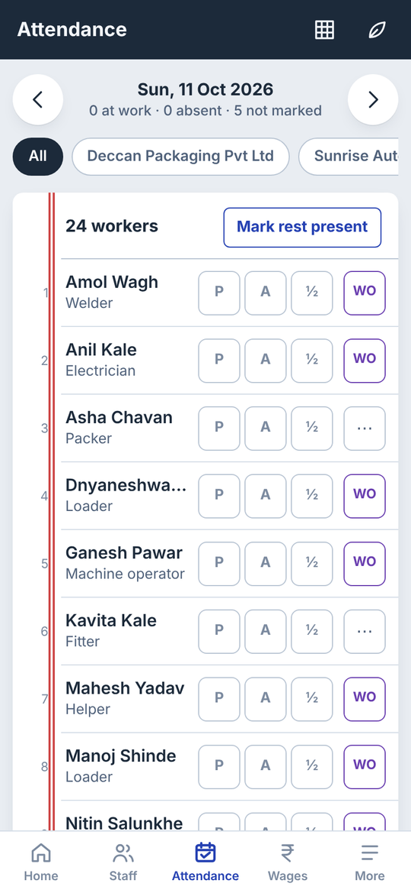
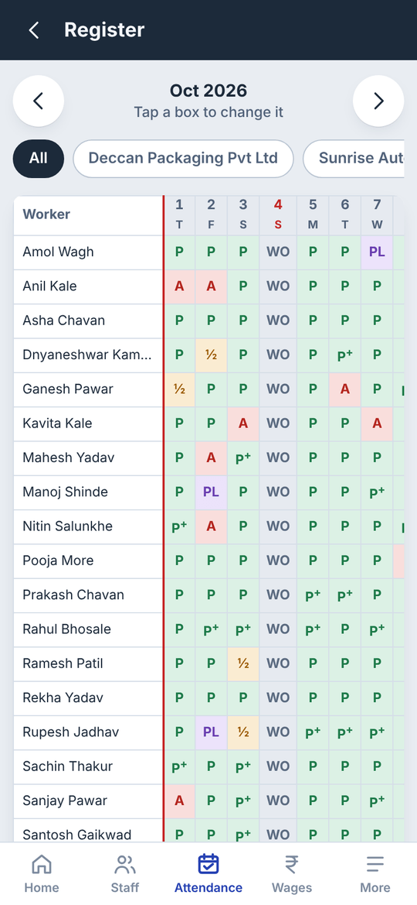
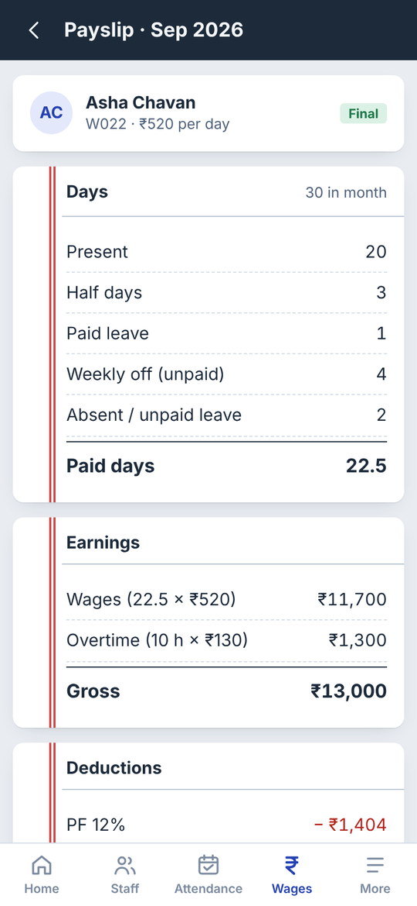
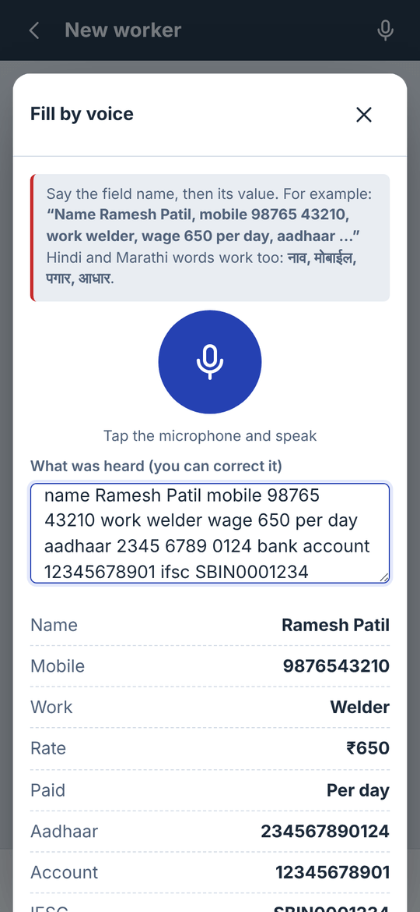
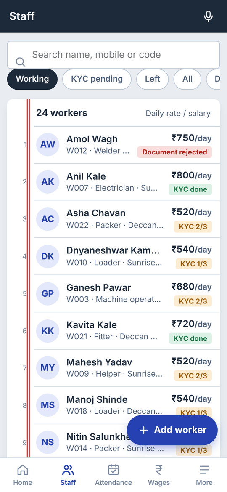
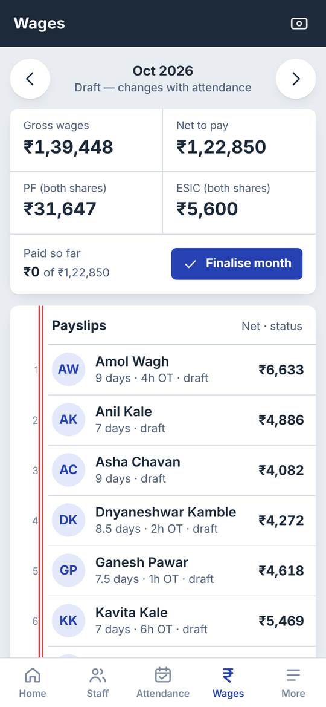
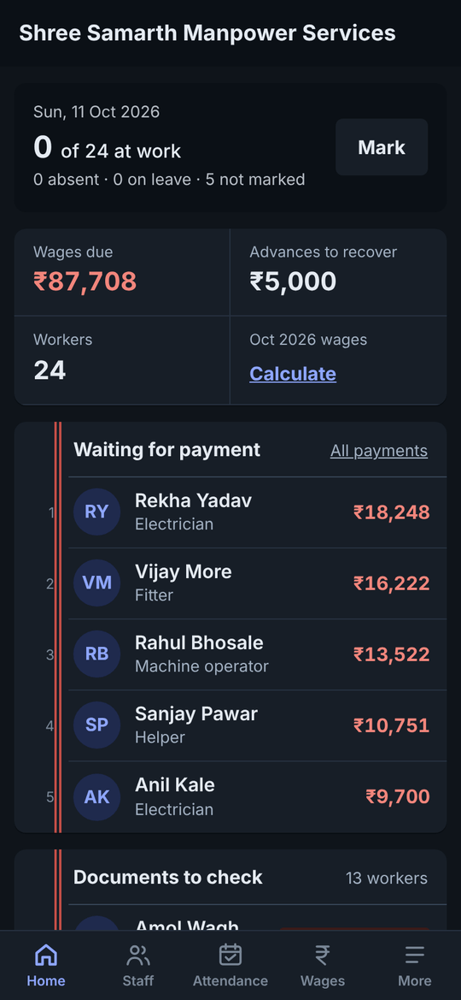
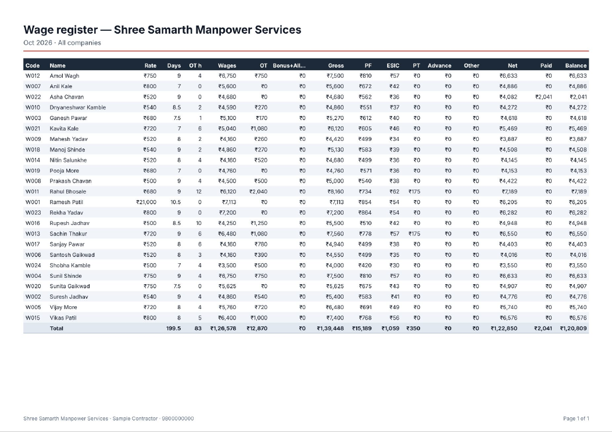

<div align="center">


# KaamKhata

**A labour contractor's register, on the phone.**
Workers, KYC documents, attendance, wages with PF/ESIC, advances and reports — fully offline, no server, no login.

[**Try it in your browser →**](https://ash051994.github.io/kaamkhata/) &nbsp;·&nbsp; [Download Android APK](../../actions/workflows/android.yml) &nbsp;·&nbsp; [Privacy policy](https://ash051994.github.io/kaamkhata/privacy.html)


</div>

---

## The problem

In MIDC industrial areas, a contractor typically supplies 50–100 workers to one or more factories. Today that runs on a paper register, a WhatsApp group and a calculator: who came today, who took ₹2,000 advance, how much PF to deposit, whose Aadhaar is still pending. Mistakes cost money and trust, and the factory's compliance team keeps asking for wage registers and PF/ESIC summaries.

KaamKhata turns that register into an app that works on a ₹8,000 Android phone at the factory gate, with no internet.

<p align="center">
  
  
  
  
</p>

## What it does

| Area | Details |
|---|---|
| **Workers** | Add workers with photo, company, work, daily or monthly rate, bank, Aadhaar/PAN/UAN/ESIC. Duplicate mobile/Aadhaar detection. Import a whole team from Excel (CSV). |
| **Voice entry** | Say *“Name Ramesh Patil, mobile 98765 43210, work welder, wage 650 per day…”* and the form fills itself. Understands English, Hindi and Marathi keywords, Devanagari digits and spoken numbers (“six hundred fifty”). Reads confirmations back aloud. |
| **Document checks** | Aadhaar validated with the Verhoeff checksum, PAN holder-type rule, IFSC, UAN, ESIC and mobile formats. Photograph each card, then mark it verified or rejected with a reason. KYC status on every worker. |
| **Attendance** | One tap per worker (P / A / ½), “mark rest present”, paid & unpaid leave, weekly off, holidays, overtime hours. Month register grid you can edit cell by cell. |
| **Wages** | Daily-rate and monthly-salary workers, overtime at 2× (Factories Act, configurable), PF 12% capped at ₹15,000 wage, ESIC 0.75% up to ₹21,000, Maharashtra profession tax slabs, bonus, allowances, advance recovery. Finalise a month to freeze payslips. |
| **Money ledger** | Advances given and recovered, full and **partial** payments per month, wages due per worker, “paid extra” detection. |
| **Reports** | PDF and Excel: worker list, attendance register, wage register, payslips (with signature lines), PF & ESIC challan summary, dues & advances, KYC status. Shared straight to WhatsApp from Android. |
| **Safety** | Optional PIN lock, one-tap backup/restore file, dark mode, everything stored only on the device. |

<p align="center">
  
  
  
  
</p>

<p align="center">
  
</p>

## How it's built

```
www/                    The whole app — plain HTML, CSS and ES modules, no framework, no build step
├── js/db.js            IndexedDB wrapper (7 stores), backup/restore
├── js/payroll.js       Pure wage functions: PF, ESIC, PT, overtime, ledger — unit tested
├── js/voice.js         Speech recognition (Web Speech API or native Android plugin) + keyword parser
├── js/pdf.js           ~230-line PDF writer: draws pages on canvas, embeds as JPEG (Devanagari-safe)
├── js/util.js          Verhoeff checksum, validators, CSV, file share
└── js/views/           Screens: home, staff, attendance, wages, reports, settings
tests/unit.mjs          Wage maths, ID validators and voice parser
tests/smoke.mjs         Playwright: walks every screen, adds a worker by voice, finalises a month,
                        records a partial payment, downloads every report
.github/workflows/      CI: tests → Android APK/AAB build → GitHub Pages deploy
```

**Decisions worth noting**

- **Offline-first, zero backend.** Contractors work where signal is weak and don't want another login. IndexedDB holds everything; a JSON backup moves data between phones. No hosting cost, no domain, nothing to breach.
- **No runtime dependencies.** The web app is about 3,000 lines of vanilla JS and 300 KB in total. It loads instantly on low-end phones and the APK stays small. Capacitor wraps it for Android and supplies native speech, text-to-speech, file and share plugins.
- **PDFs without a PDF library.** Worker names are often in Devanagari. Instead of bundling fonts, each page is drawn on a canvas with the phone's own fonts and embedded as an image in a hand-written PDF structure.
- **Money logic is pure and tested.** `calcPay()` takes a worker, attendance and settings and returns every figure on the payslip, so the same function drives the screen, the PDF and the tests.
- **Built for the actual user.** Big tap targets, one-tap marking, plain-language labels, Hindi/Marathi voice keywords, numbers in Indian format, and a design borrowed from the red-margined paper *khata* contractors already know.

## Run it

```bash
# Web version (any phone or computer)
npm run serve                     # http://localhost:8080 — load sample data from More → Backup

# Tests
node tests/unit.mjs
npm install --no-save playwright && npx playwright install chromium
npm run serve & node tests/smoke.mjs

# Android
npm install --legacy-peer-deps
npx cap add android && npx cap sync android
npx cap open android              # build or run from Android Studio
```

Every push to `main` builds a debug APK in GitHub Actions (download it from the run's **Artifacts**). Tagging `v1.0.0` attaches the APK to a GitHub release, and a signed Play Store bundle is built when signing secrets are added — see [docs/PLAY_STORE.md](docs/PLAY_STORE.md).

## Roadmap

- Google Play Billing: free up to 15 workers, paid plan for unlimited
- Encrypted Google Drive auto-backup
- Marathi and Hindi interface translations
- Worker self-check via WhatsApp payslip link
- Face or QR attendance at the gate

## Author

**Ashwin Gaikwad** — full-stack developer (PHP/WordPress, Node, React, Python, AWS, AI/MCP tooling), Maharashtra.
[GitHub](https://github.com/ash051994) · [LinkedIn](https://www.linkedin.com/in/ashwin-gaikwad-dev) · ash051994@outlook.com

<sub>Source is published for evaluation. See [LICENSE](LICENSE).</sub>
